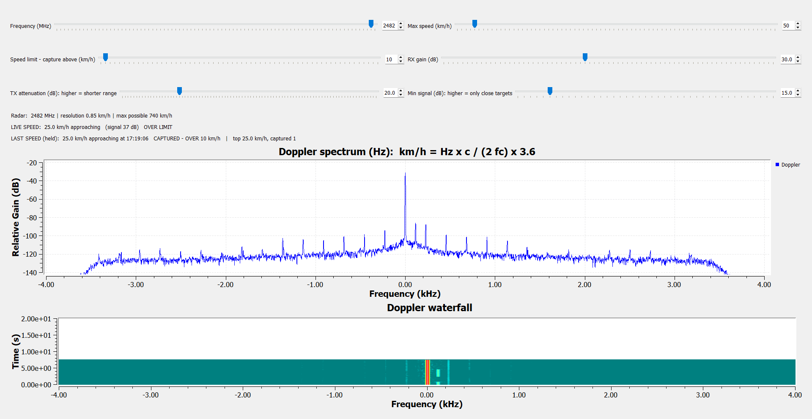

# SDR-Based Doppler Radar for Velocity Measurement

Final Year Project, PNEC-NUST, Electronics & Power Engineering.

A continuous-wave (CW) Doppler radar built on an **ADALM-PLUTO** software-defined radio with
**GNU Radio** (main version) and Python (backup version). It measures the speed of moving targets
(people, bicycles, cars) in real time and works like a street speed camera:

- shows the live speed in km/h on the laptop and on a 4-digit LED display
- **adjustable frequency** (2400-2483 MHz) and **maximum speed** (up to ~740 km/h), live from GNU Radio sliders
- holds each pass's **peak speed** until the next pass
- **captures** passes faster than a set speed limit (red on screen, blinking on the LED, logged)
- sounds an alarm: louder and higher-pitched for faster targets, faster beeps for closer ones
- logs every pass to `speed_log.csv` (date, time, speed, direction, limit, captured)



## How it works

```
Laptop (GNU Radio) ──USB── PlutoSDR ── Tx antenna ──►  moving target
                                └── Rx antenna ◄──  Doppler-shifted echo
Laptop ──USB── Arduino Nano ── TM1637 LED display + buzzer
```

The Pluto transmits a CW tone at 2.482 GHz. The echo from a moving target is shifted by the Doppler
frequency `fd = 2·v·fc / c`. The GNU Radio flowgraph (`SDR_Radar_Deploy/gnuradio/doppler_radar.grc`)
mixes the echo down and decimates it to 8 kS/s; its Doppler Speed Camera block takes a 4096-point FFT,
finds the Doppler peak and converts it to speed: `v = fd · c / (2·fc)`. The Python version uses the same
detector (`doppler_core.py`).

| Parameter | Value |
|---|---|
| Carrier | 2.482 GHz default, adjustable 2400-2483 MHz (2.4 GHz ISM band) |
| FFT | 2048 points over 0.26 s, 3.9 Hz bins, 0.1 km/h readout (peak interpolation) |
| Speed range | about 3.3 km/h to the max-speed setting (default 220, up to ~740 km/h), approaching and receding |
| Update rate | 64 ms; held speed on the LED about 0.75 s after the target leaves |

## Quick start

1. Plug the Pluto into its **middle** micro-USB port, and the Arduino Nano (optional) into another USB port.
2. Double-click **`SDR_Radar_Deploy/START_GNURADIO.bat`** (needs radioconda, see DEPLOY.md).
3. Stand still for 3 s while it learns the background; use the sliders for frequency, max speed and
   speed limit. Close the window to stop.
   Block diagram: `EDIT_GNURADIO.bat`. Python backup: `START_RADAR.bat`. Tests: `TOOLS.bat` (optional).

Setting up on another laptop: see **[SDR_Radar_Deploy/DEPLOY.md](SDR_Radar_Deploy/DEPLOY.md)**.
Full technical details, wiring and troubleshooting: **[SDR_Radar_Deploy/README.md](SDR_Radar_Deploy/README.md)**.

## Hardware

| Part | Notes |
|---|---|
| ADALM-PLUTO SDR | firmware v0.39 (files in `SDR_Radar_Deploy/pluto_recovery/`) |
| 2 × 2.4 GHz antennas | SMA male; one on Tx, one on Rx |
| SMA extension cable, 0.5–1 m | separates the Rx antenna from the Tx antenna |
| Arduino Nano + TM1637 4-digit display | optional speed display |
| Passive buzzer, NPN transistor, 1 kΩ, diode | optional buzzer alarm |
| Windows laptop with radioconda (GNU Radio 3.10) and Python 3.10+ | |

## Repository layout

| Path | Contents |
|---|---|
| `SDR_Radar_Deploy/` | Everything needed to run the radar: launchers, GNU Radio flowgraph, Python code, Arduino sketch, drivers, firmware |
| `docs/` | CDRB presentation (PPTX and PDF) |
| `photos/` | Hardware photos |

## Team

S/LT Bilal PN, S/LT Sanaullah PN, S/LT Farhan PN, S/LT Huzaifa PN
Advisor: Assistant Professor Mohammad Mustaqim
