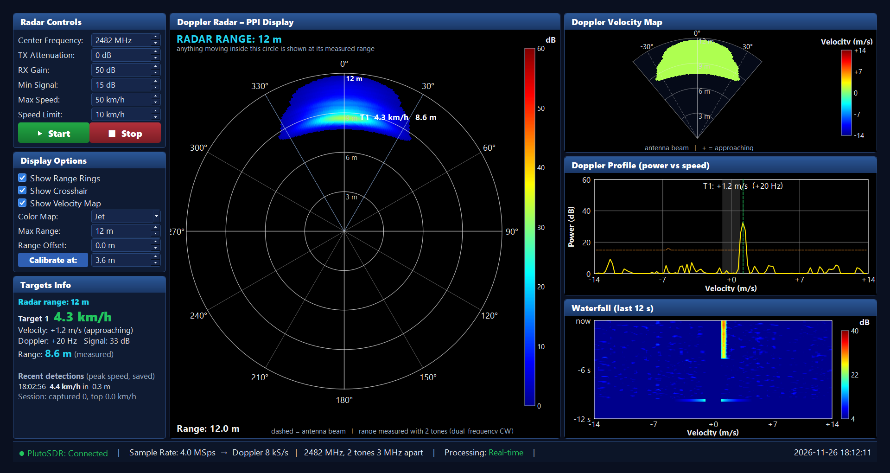
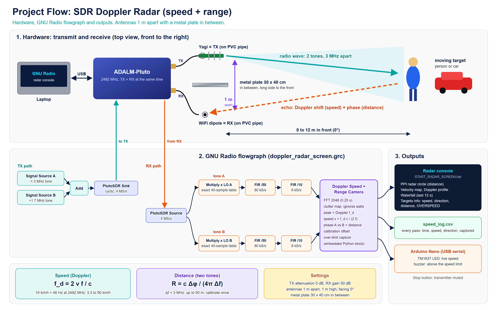

# SDR-Based Doppler Radar for Velocity Measurement

Final Year Project, PNEC-NUST, Electronics & Power Engineering.

A continuous-wave radar built on an **ADALM-PLUTO** software-defined radio with **GNU Radio** (main version)
and Python (backup version). It measures the **speed and the distance** of moving targets (people, bicycles,
cars) in real time and works like a street speed camera:

- radar console in the GNU Radio window: **PPI radar circle**, velocity map, Doppler profile, **waterfall**,
  targets info, controls and Start / Stop
- **speed** from the Doppler shift, **distance** from two tones 3 MHz apart (dual-frequency CW, up to 50 m,
  display 12 m), one-button calibration
- keeps the **last detection** on screen and the last 5 detections; saves every detection to
  `detections_log.csv` (speed, direction, Doppler, signal, distance, overspeed)
- **captures** passes faster than a set speed limit (red on screen, blinking on the LED, logged in `speed_log.csv`)
- 4-digit LED display and buzzer alarm on an Arduino Nano





## How it works

```
Laptop (GNU Radio) ──USB── PlutoSDR ── TX: Yagi antenna ──►  moving target
                                └───── RX: dipole antenna ◄──  echo (Doppler shift + phase)
          antennas 1 m apart, metal plate in between
Laptop ──USB── Arduino Nano ── TM1637 LED display + buzzer
```

The Pluto transmits two tones around 2.482 GHz, 3 MHz apart. The echo of a moving target is shifted by the
Doppler frequency `fd = 2·v·fc / c`, which gives the speed: `v = fd · c / (2·fc)`. The two echoes arrive with
a phase difference that grows with distance, which gives the range: `R = c·Δφ / (4π·Δf)` (unique up to 50 m).
The GNU Radio flowgraph (`SDR_Radar_Deploy/gnuradio/doppler_radar_screen.grc`) mixes each tone to 0 Hz with an
exact 40-sample table, decimates to 8 kS/s, and its Doppler Speed + Range Camera block takes a 2048-point FFT,
removes the room with a clutter map, finds the Doppler peak and measures the phase difference. The detector is
shared with the Python version (`doppler_core.py`).

| Parameter | Value |
|---|---|
| Carrier | 2.482 GHz default, adjustable 2400-2483 MHz (2.4 GHz ISM band); tones at -1.3 and +1.7 MHz |
| Sample rate | 4 MS/s from the Pluto, 8 kS/s for the Doppler |
| FFT | 2048 points over 0.26 s, 3.9 Hz bins (0.85 km/h), 0.1 km/h readout (peak interpolation) |
| Speed range | about 3.3 km/h to the max-speed setting (default 50, up to ~740 km/h), approaching and receding |
| Distance | unique up to 50 m; within 0.4 m in simulation tests; calibrate once per place |
| Settings | TX attenuation 0 dB, RX gain 50 dB (tuned on the Pluto, no clipping) |
| Update rate | 15.6 radar frames per second; screen 10 per second |

## Quick start

1. Set up the antennas: Yagi (TX) and dipole (RX) 1 m apart, 1 m high, both facing the front, metal plate in
   between. Plug the Pluto into its **middle** micro-USB port and wait 30 s; plug in the Arduino Nano (optional).
2. Double-click **`SDR_Radar_Deploy/START_RADAR_SCREEN.bat`** (needs radioconda, see DEPLOY.md). GNU Radio
   Companion shows the flowgraph and the radar console opens.
3. Stand still for 3 s while it learns the background, then press **Calibrate at** once at a measured distance.
   Press Stop or close the window to stop (the transmitter is muted).

Classic speed-only version: `START_GNURADIO.bat` ([sliders](photos/gnuradio_controls.png),
[spectrum](photos/gnuradio_spectrum.png), [flowgraph](photos/gnuradio_flowgraph.png)).
Python backup: `START_RADAR.bat`. Tests: `TOOLS.bat`.

Setting up on another laptop or updating an old one: see **[SDR_Radar_Deploy/DEPLOY.md](SDR_Radar_Deploy/DEPLOY.md)**.
Full technical details, wiring and troubleshooting: **[SDR_Radar_Deploy/README.md](SDR_Radar_Deploy/README.md)**.

## Hardware

| Part | Notes |
|---|---|
| ADALM-PLUTO SDR (Rev B) | firmware v0.39 (files in `SDR_Radar_Deploy/pluto_recovery/`) |
| 2.4 GHz Yagi antenna (TX) | about 8 dBi, board standing, arrow to the front |
| 2.4 GHz dipole antenna (RX) | on an SMA extension cable |
| 2 PVC pipes | hold the antennas 1 m apart, 1 m above the ground |
| Metal plate 30 × 40 cm | between the antennas, keeps the TX signal out of the RX antenna |
| Arduino Nano + TM1637 4-digit display | optional speed display |
| Passive buzzer, NPN transistor, 1 kΩ, diode | optional buzzer alarm |
| Windows laptop with radioconda (GNU Radio 3.10) and Python 3.10+ | |

## Repository layout

| Path | Contents |
|---|---|
| `SDR_Radar_Deploy/` | Everything needed to run the radar: launchers, GNU Radio flowgraphs, Python code, Arduino sketch, drivers, firmware |
| `docs/` | Presentation guide, easy guide, deployment and range guides, diagrams, CDRB presentation |
| `photos/` | Radar console, project flow, hardware photos |

## Team

S/LT Bilal PN, S/LT Sanaullah PN, S/LT Farhan PN, S/LT Huzaifa PN
Advisor: Assistant Professor Mohammad Mustaqim
