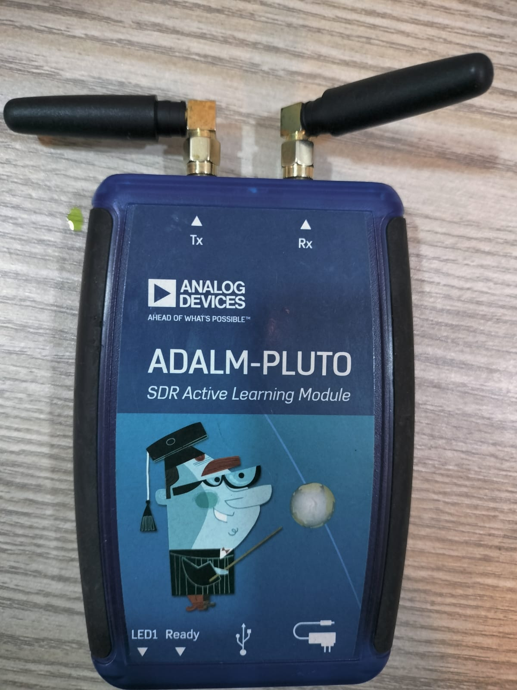

# SDR-Based Doppler Radar for Velocity Measurement

Final Year Project, PNEC-NUST, Electronics & Power Engineering.

A continuous-wave (CW) Doppler radar built on an **ADALM-PLUTO** software-defined radio. It measures the
speed of moving targets (people, bicycles, cars) in real time and works like a street speed camera:

- shows the live speed in km/h with one decimal on the laptop and on a 4-digit LED display
- holds each pass's **peak speed** until the next pass
- **captures** passes faster than a set speed limit (red on screen, blinking on the LED, logged)
- sounds an alarm: louder and higher-pitched for faster targets, faster beeps for closer ones
- logs every pass to `speed_log.csv` (date, time, speed, direction, limit, captured)



## How it works

```
Laptop (Python) ──USB── PlutoSDR ── Tx antenna ──►  moving target
                                └── Rx antenna ◄──  Doppler-shifted echo
Laptop ──USB── Arduino Nano ── TM1637 LED display + buzzer
```

The Pluto transmits a CW tone at 2.482 GHz. The echo from a moving target is shifted by the Doppler
frequency `fd = 2·v·fc / c`. The Python program mixes the echo down, takes a 4096-point FFT at 8 kS/s,
finds the Doppler peak and converts it to speed: `v = fd · c / (2·fc)`.

| Parameter | Value |
|---|---|
| Carrier | 2.482 GHz (2.4 GHz ISM band) |
| FFT | 4096 points over 0.5 s, 1.95 Hz bins, 0.1 km/h readout (peak interpolation) |
| Speed range | about 3.3 to 218 km/h, approaching and receding |
| Update rate | 64 ms |

## Quick start

1. Plug the Pluto into its **middle** micro-USB port, and the Arduino Nano (optional) into another USB port.
2. Double-click **`SDR_Radar_Deploy/START_RADAR.bat`**.
3. The radar starts by itself (speed limit 50 km/h). Close the plot window to stop.
   Tests and walking mode (limit 10 km/h): double-click `SDR_Radar_Deploy/TOOLS.bat`.

Setting up on another laptop: see **[SDR_Radar_Deploy/DEPLOY.md](SDR_Radar_Deploy/DEPLOY.md)**.
Full technical details, wiring and troubleshooting: **[SDR_Radar_Deploy/README.md](SDR_Radar_Deploy/README.md)**.

## Hardware

| Part | Notes |
|---|---|
| ADALM-PLUTO SDR | firmware v0.39 (files in `SDR_Radar_Deploy/pluto_recovery/`) |
| 2 × 2.4 GHz antennas | SMA male; one on Tx, one on Rx |
| SMA extension cable, 0.5–1 m | separates the Rx antenna from the Tx antenna |
| Arduino Nano + TM1637 4-digit display | optional speed display |
| Passive buzzer, NPN transistor, 1 kΩ, diode | optional buzzer alarm |
| Windows laptop with Python 3.10+ | |

## Repository layout

| Path | Contents |
|---|---|
| `SDR_Radar_Deploy/` | Everything needed to run the radar: launcher, Python code, Arduino sketch, drivers, firmware |
| `docs/` | CDRB presentation (PPTX and PDF) |
| `photos/` | Hardware photos |

## Team

S/LT Bilal PN, S/LT Sanaullah PN, S/LT Farhan PN, S/LT Huzaifa PN
Advisor: Assistant Professor Mohammad Mustaqim
